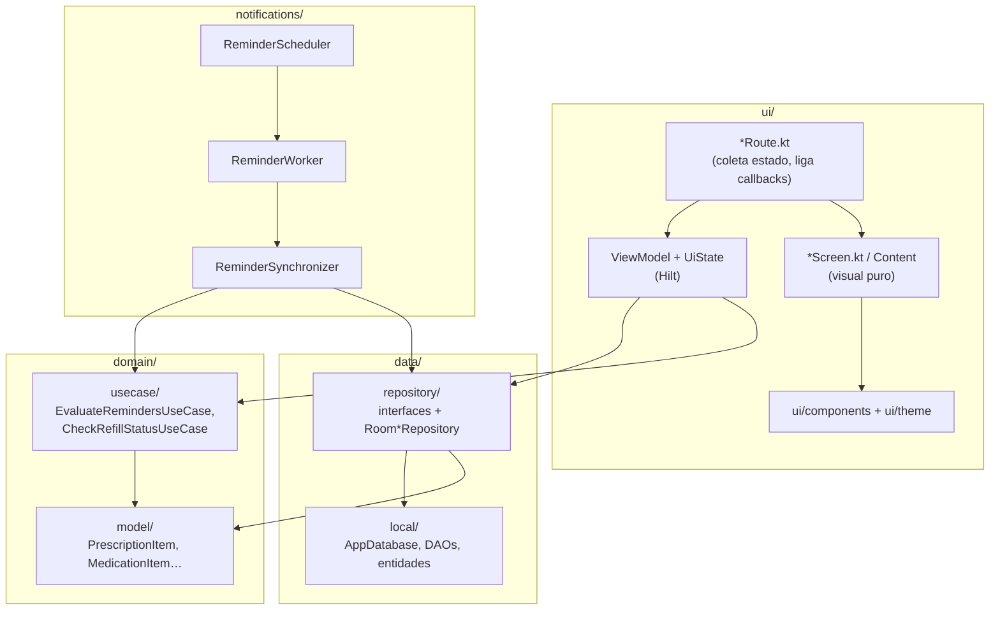

# Arquitetura

Visão técnica do Receitas, verificada no código em 15/10/2026. Para regras de negócio, veja [modelagem.md](modelagem.md). Para o padrão de telas, veja [apresentacao.md](apresentacao.md).

## Visão geral

App de módulo único (`:app`), Kotlin, Jetpack Compose com Material 3, Room, Hilt, Navigation Compose e WorkManager. Não há rede, backend nem conta de usuário.

## Camadas

### `data/`

- `local/AppDatabase.kt`: Room **versão 4**, schema exportado em `app/schemas/`. Banco `receitas_database`. Migrações explícitas `FROM_2_TO_3` e `FROM_3_TO_4` em `DatabaseMigrations.kt`. Não há fallback destrutivo.
- Sete entidades: `DoctorEntity`, `MedicationEntity`, `PrescriptionEntity`, `PrescriptionMedicationEntity` (item da receita), `PickupTrackingEntity` (acompanhamento), `PickupEventEntity` (retirada) e `NotificationEntity`.
- `Converters.kt` converte tipos para texto. O tipo da receita usa o conversor textual existente, sem alterar o schema.
- `repository/`: interfaces para médicos, medicamentos, receitas, notificações e **registro completo de receita** (`PrescriptionRegistrationRepository`). O registro grava receita, itens, acompanhamentos e eventos em **uma transação Room**.

### `domain/`

- `model/`: modelos de domínio e as exceções de regra de negócio (`BusinessRuleViolation`). Falhas técnicas são tratadas à parte e recebem mensagem de recuperação na interface.
- `usecase/EvaluateRemindersUseCase.kt`: recebe receitas, medicamentos e a data atual e devolve os alertas devidos. É código puro, coberto por testes unitários.
- `usecase/CheckRefillStatusUseCase.kt`: situação de retirada de um acompanhamento.

### `ui/`

Cada funcionalidade em `ui/feature/<área>/` segue `Route → estado e callbacks → Screen/Content`:

- `*Route.kt` coleta o estado respeitando o ciclo de vida e liga callbacks ao ViewModel.
- `*Screen.kt` recebe `UiState` e callbacks. Não importa ViewModel, repositório nem navegação.
- ViewModels carregam, salvam e coordenam ações.

`ui/components` reúne os componentes compartilhados e `ui/theme/DesignSystem.kt` os tokens. As regras de uso estão em [DESIGN.md](../DESIGN.md).

### `di/`

Dois módulos Hilt em `SingletonComponent`:

- `DatabaseModule` provê o `AppDatabase` e os DAOs.
- `RepositoryModule` liga as interfaces às implementações Room.

`ReceitasApplication` é `@HiltAndroidApp` e `MainActivity` é `@AndroidEntryPoint`. Todos os ViewModels são `@HiltViewModel`.

### `notifications/`

O caminho de lembretes **não usa Hilt**:

- `ReminderScheduler` agenda `daily-reminders` (periódico, 1 dia, política `KEEP`) e `reminder-refresh` (execução única, `APPEND_OR_REPLACE`).
- `ReminderWorker` é um `CoroutineWorker` simples. Chama `ReminderSynchronizer.sync`. Falhas viram `Result.retry()` e o cancelamento é propagado.
- `ReminderSynchronizer` é um `object` que obtém o banco por `AppDatabase.getDatabase(context)`, instancia os repositórios Room manualmente, avalia os alertas, grava o histórico interno e entrega as notificações do Android. Cria o canal de notificações e respeita permissão negada e canal desativado.

A verificação extra roda em `ReceitasApplication` (ao mudar receitas, medicamentos, acompanhamentos ou retiradas, com até três novas tentativas se a observação falhar) e em `MainActivity` (ao abrir o app e quando a permissão é concedida). Regras completas em [lembretes.md](lembretes.md).

> [!NOTE]
> Como o sincronizador cria os repositórios por conta própria, qualquer mudança no construtor de `RoomPrescriptionRepository` ou `RoomMedicationRepository` precisa ser refletida em `ReminderSynchronizer`. O Hilt não vai avisar.

## Navegação

`MainScreen` cria o `NavController`, observa o destino atual e decide qual aba está selecionada, se a barra aparece e qual ação de criação mostrar. `ReceitasNavHost` define o grafo e injeta os ViewModels com `hiltViewModel()`.

| Rota | Tela | Observação |
| --- | --- | --- |
| `home` | Início | Destino inicial. Abre Notificações pelo sino. |
| `prescriptions` | Receitas | Aba. |
| `medications` | Remédios | Aba. O título interno em `NavRoute` é "Medicamentos". |
| `prescription_detail/{prescriptionId}` | Detalhe da receita | |
| `medication_detail/{medicationId}` | Detalhe do medicamento | Mesma rota para quem chega por Remédios ou pela receita. |
| `prescriptions_for_medication/{medicationId}` | Receitas filtradas por medicamento | Reutiliza `PrescriptionsScreen` com `medicationFilterId`. O filtro pertence a essa entrada. |
| `prescription_wizard?prescriptionId&entryMode&renewalOf&medicationId&addToPrescriptionId` | Cadastro | Veja os modos abaixo. |
| `notifications` | Notificações | Também aberta ao tocar numa notificação do Android. |
| `menu` | Menu | Registrada no grafo, mas **fora da barra**. Veja [pendencias.md](pendencias.md#d4). |

### Modos do wizard

`WizardEntryMode` só distingue `FULL_PRESCRIPTION` (padrão) de `STANDALONE_MEDICATION`. O fluxo concreto vem da combinação dos parâmetros da rota:

| Entrada | Parâmetros |
| --- | --- |
| Nova receita | nenhum |
| Medicamento avulso | `entryMode=STANDALONE_MEDICATION` |
| Editar receita | `prescriptionId=<id>` |
| Editar medicamento | `entryMode=STANDALONE_MEDICATION&medicationId=<id>` |
| Renovar receita | `renewalOf=<id>` |
| Adicionar medicamento pela lista da receita | `entryMode=STANDALONE_MEDICATION&addToPrescriptionId=<id>` |

O último é a exceção que vincula automaticamente a receita de origem ao acompanhamento. O estado do cadastro sobrevive à recriação da Activity via `SavedStateHandle`.

### Barra de navegação

`TextNavigationBar` desenha a cápsula flutuante. `NavRoute.bottomNavItems` ainda inclui `Menu`, mas a barra o filtra e mostra só Início, Receitas e Remédios. Sua altura medida é a reserva no fim das listas. Em Receitas e Remédios, `MainScreen` passa `onCreateRecord` e a barra mostra a ação "+" junto à cápsula (decisão do autor em 15/10/2026). Nas demais rotas, a ação não aparece.

## Estado e erros

- Estado de tela é um `UiState` imutável exposto por `StateFlow`.
- Cada lista distingue **carregando, erro, vazio e vazio por filtro**. Ao trocar uma tela, preserve os quatro.
- Recarregar cancela o coletor anterior antes de assinar de novo.
- Argumento de rota ausente vira estado recuperável, não exceção.
- Regra de negócio violada usa `BusinessRuleViolation`. Falha técnica é registrada em log e mostra mensagem de recuperação.

A auditoria que fixou esses padrões está em [auditoria.md](auditoria.md).

## Testes

| Tipo | Pasta | O que cobre |
| --- | --- | --- |
| Unitários | `app/src/test` | Regras de lembrete, estados do wizard, filtros, tratamento de falhas, apresentação de notificações, situação de retirada. |
| Instrumentados | `app/src/androidTest` | Migrações 2→3 e 3→4, persistência e rollback, fluxos de interface, composição em 320 × 640 dp, fonte 200% e temas claro/escuro. |

`ComposeCapture.kt` salva capturas de tela dos testes de interface. A aquisição da imagem repete até três vezes só para falhas transitórias de captura. Cliques e asserções nunca são repetidos.

## Configuração de build a conhecer

- `minSdk` 26, `targetSdk` e `compileSdk` 37, `versionName` 1.0.
- `compileOptions` em Java 11, enquanto o Gradle roda com JDK 25.
- Build `release` com otimização **desativada** (`optimization { enable = false }`) e sem assinatura própria. Veja [pendencias.md](pendencias.md#d6).
- `gradle.properties` define `android.disallowKotlinSourceSets=false`, opção experimental que gera aviso em todo build.
- Backup e transferência entre dispositivos estão desativados, e os arquivos de dados são excluídos explicitamente (`backup_rules.xml`, `data_extraction_rules.xml`).
