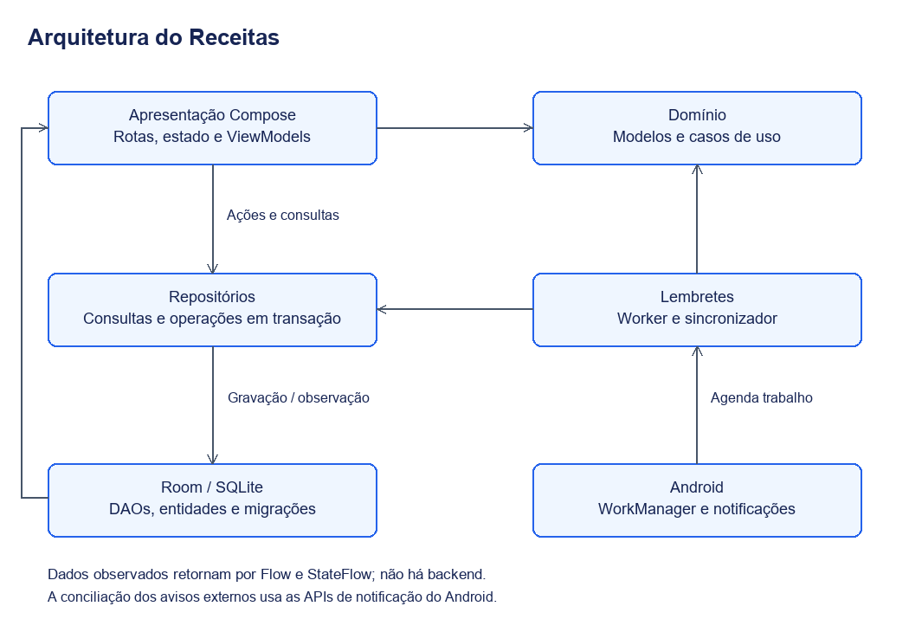
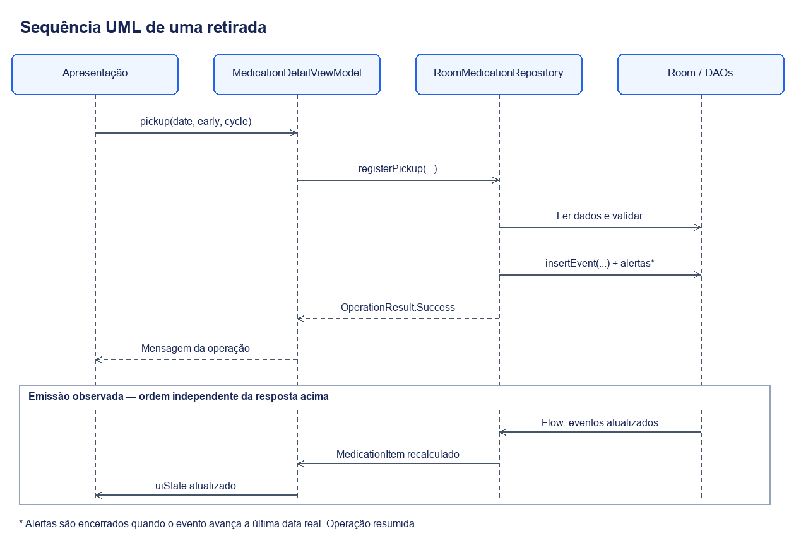
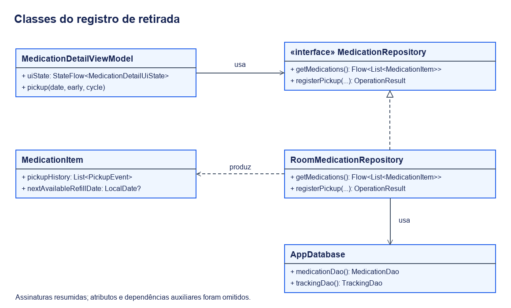

# Arquitetura

O Receitas usa uma Activity e interface em Jetpack Compose. O código está em um único módulo Android, `:app`, organizado em apresentação, domínio e dados. Essa organização usa ViewModels e repositórios, com fluxo reativo de dados; não pressupõe uma implementação rigorosa de Clean Architecture.

A separação permite testar o cálculo de um prazo sem abrir uma tela e salvar um registro sem colocar operações de banco dentro de composables. As funcionalidades continuam próximas em `ui/feature/`, enquanto componentes visuais reutilizáveis ficam em `ui/components/`.

## Visão geral

[Versão vetorial](imagens/arquitetura.svg).

| Parte | Responsabilidade no Receitas |
| --- | --- |
| `ui/feature/` | Cadastros, listas e detalhes, com estados e ViewModels por funcionalidade |
| `ui/navigation/` | Destinos e callbacks de navegação |
| `ui/components/` e `ui/theme/` | Componentes, cores, medidas e tipografia compartilhados |
| `domain/model/` | Receita, medicamento, intervalo, eventos e propriedades calculadas |
| `domain/usecase/` | Situação de retirada e condições dos lembretes |
| `data/repository/` | Operações de leitura e escrita e coordenação de transações |
| `data/local/` | Entidades, DAOs, conversores, banco e migrações Room |
| `notifications/` | Agendamento, sincronização e entrega de avisos Android |
| `di/` e `text/` | Fornecimento de dependências e resolução de mensagens |

Os diretórios partem de `app/src/main/java/cc/rhuan/receitas/`. O banco local é a fonte persistente dos registros; não existe outra fonte remota para sincronizar.

## Exemplo completo: registrar uma retirada

Ao confirmar a data no detalhe do medicamento, a apresentação chama `MedicationDetailViewModel.pickup`. O ViewModel executa a ação em coroutine e chama `MedicationRepository.registerPickup`. A implementação Room valida o medicamento e o acompanhamento dentro de uma transação.

Se a operação for permitida, o repositório grava `PickupEventEntity` e encerra os alertas de retirada quando o evento avança a última data real. O resultado da operação produz uma mensagem para a interface. Em paralelo à resposta da ação, os fluxos Room emitem a mudança do histórico: o repositório reconstrói `MedicationItem` e o ViewModel atualiza `uiState`. A próxima previsão é uma propriedade derivada, não uma data fixa gravada no evento.

[Versão vetorial](imagens/sequencia-retirada.svg). O desenho separa a resposta da operação da emissão dos fluxos; a ordem relativa entre esses dois retornos pode variar. Caminhos de recusa estão no [fluxo de retirada](funcionamento.md#registro-de-retirada).

| Etapa | Código para acompanhar |
| --- | --- |
| Receber a ação e apresentar o resultado | [MedicationDetailViewModel.kt](../app/src/main/java/cc/rhuan/receitas/ui/feature/medications/MedicationDetailViewModel.kt) |
| Validar e gravar em transação | [MedicationRepository.kt](../app/src/main/java/cc/rhuan/receitas/data/repository/MedicationRepository.kt) |
| Persistir e observar eventos | [TrackingDao.kt](../app/src/main/java/cc/rhuan/receitas/data/local/dao/TrackingDao.kt) |
| Derivar a próxima previsão | [MedicationItem.kt](../app/src/main/java/cc/rhuan/receitas/domain/model/MedicationItem.kt) |

### Classes desse percurso

[Versão vetorial](imagens/classes-retirada.svg). As assinaturas estão resumidas e as dependências auxiliares foram omitidas. A seta tracejada com triângulo indica que a implementação Room realiza a interface; as demais relações mostram dependências.

## Estado dos cadastros

Os percursos de receita e medicamento são separados, mas compartilham `PrescriptionWizardViewModel` e `PrescriptionWizardUiState`. O estado contém campos, rascunhos, etapa atual, validações e situação do salvamento. A apresentação muda o conteúdo conforme a etapa, sem abrir uma rota independente para cada pergunta.

O ViewModel expõe um `StateFlow` e mantém uma cópia serializável em `SavedStateHandle`, na chave `registration_draft`, sem as listas de sugestões carregadas dos repositórios. Isso permite recuperação quando o Android recria a tela ou restaura a entrada. Não oferece uma lista de rascunhos permanentes para retomar depois de descartar o cadastro.

Subeditores opcionais usam rascunhos próprios: confirmar aplica a alteração; voltar preserva o formulário anterior. A revisão permite editar um assunto e retornar diretamente ao resumo. O estado serializado completo pode crescer com o formulário; esse é um limite técnico a considerar se o cadastro aumentar.

## Navegação e apresentação

`MainScreen` cria o controlador de navegação e `PrescriptionsNavHost` define o grafo. As funções em `*Route.kt` coletam o estado com o ciclo de vida e conectam ações aos composables de apresentação. Estes recebem dados e callbacks em vez de consultar DAOs diretamente.

Uma receita abre a lista de seus medicamentos; selecionar um item abre o mesmo detalhe usado em Remédios. No caminho inverso, Receitas vinculadas abre uma entrada de lista filtrada por participação. Esse filtro pertence à entrada e não modifica a aba principal de Receitas.

Carregamento, falha, coleção vazia, busca sem resultados e registro ausente são tratados como situações diferentes. Recarregar cancela a observação anterior antes de iniciar outra. O cancelamento de coroutines é preservado; falhas recuperáveis recebem retorno na interface.

## Execução dos lembretes

`ReminderScheduler` agenda o trabalho diário e verificações pontuais. `ReminderWorker` chama `ReminderSynchronizer`, que consulta os dados, usa `EvaluateRemindersUseCase` e concilia os alertas internos com as notificações Android. O algoritmo de avaliação recebe a data atual, o que permite testar limites de antecedência e conflitos sem depender do relógio do dispositivo.

Os alertas internos ficam no Room. Informações de entrega e supressão por etapa também são mantidas em preferências locais, para evitar reenvios indevidos. O Android pode adiar a execução periódica; a aplicação também verifica os dados ao abrir e depois de alterações relevantes.

O caminho de sincronização constrói repositórios manualmente, enquanto os ViewModels usam Hilt. Portanto, mudanças nos construtores desses repositórios também precisam ser refletidas no sincronizador. Essa é uma diferença da implementação atual que não aparece se o projeto for descrito apenas como “usa injeção de dependências”.
