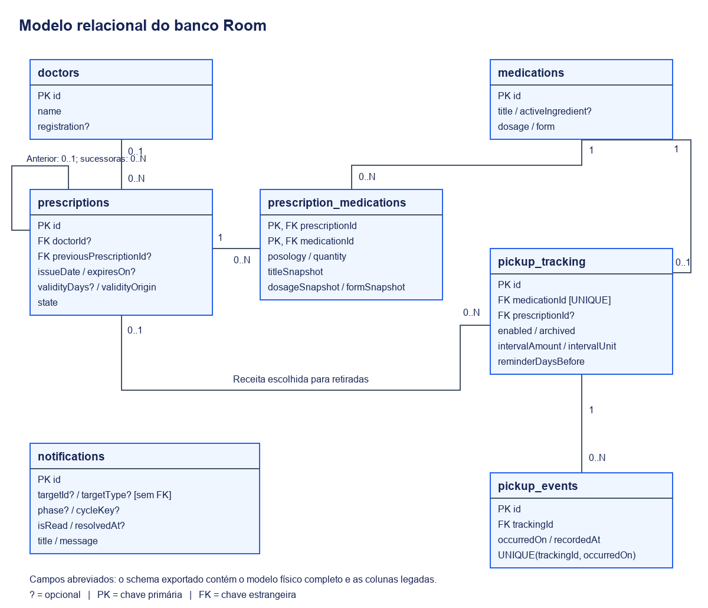

# Banco de dados

O banco separa o documento prescrito, o cadastro de medicamento e os eventos de retirada. Essa separação evita que uma mudança no nome ou na apresentação atual de um medicamento reescreva o conteúdo de uma receita anterior, e permite corrigir o histórico sem substituir o documento.

A persistência usa Room sobre SQLite. `AppDatabase` está na versão 4, com banco `receitas_database` e schemas exportados em `app/schemas/`. Não há servidor nem fallback destrutivo.

## Modelo relacional

[Versão vetorial](imagens/dados.svg). O desenho mostra os campos relevantes aos relacionamentos e aos prazos, não todas as colunas. `PK` identifica chave primária, `FK` identifica chave estrangeira e `?` indica campo opcional. As linhas representam relacionamentos, sem direção de fluxo de dados.

| Tabela | Conteúdo |
| --- | --- |
| `doctors` | Cadastro reutilizável de profissional |
| `prescriptions` | Emissão, vencimento, preferências de lembrete e estado da receita |
| `medications` | Identidade e apresentação atual do medicamento |
| `prescription_medications` | Item prescrito, com orientação, quantidade e cópias dos dados apresentados no documento |
| `pickup_tracking` | Configuração do acompanhamento de um medicamento |
| `pickup_events` | Datas reais das retiradas e momento de seu registro |
| `notifications` | Histórico interno dos alertas, com alvo, ciclo, fase e encerramento |

## Receita e medicamento

`prescription_medications` resolve a relação de muitos para muitos. Sua chave é o par `prescriptionId` e `medicationId`, impedindo repetição do mesmo medicamento em um documento. Nome, concentração e forma são preservados em campos de snapshot; orientação e quantidade prescritas pertencem ao item.

`pickup_tracking.medicationId` tem índice único: um medicamento pode ter no máximo um acompanhamento. A referência `prescriptionId` é opcional e define a receita usada para retiradas. Essa chave é diferente da participação em `prescription_medications`.

Uma receita pode ser referenciada por vários acompanhamentos. A regra de aplicação valida a escolha; a chave estrangeira, sozinha, não garante que o medicamento participa daquele documento. A inclusão pela lista de receita ativa coordena a criação do item e a configuração do acompanhamento em transação.

## Histórico e datas derivadas

Um acompanhamento tem vários eventos. O par `trackingId` e `occurredOn` é único, impedindo duas retiradas na mesma data para o mesmo acompanhamento. `occurredOn` é a data real; `recordedAt` é quando a pessoa registrou a informação.

Última retirada e próxima previsão são reconstruídas a partir dos eventos e do intervalo. Corrigir ou excluir um evento pode mudar o resultado. Uma data retroativa só passa a determinar a previsão se for a maior data real restante.

A renovação usa `prescriptions.previousPrescriptionId`, uma referência opcional ao documento anterior. Dados do profissional também são preservados na própria receita, além da referência opcional a `doctors`.

`notifications.targetId` e `targetType` identificam logicamente o alvo do alerta, mas não formam uma chave estrangeira Room. `phase` e `cycleKey` distinguem etapas e ciclos. Por isso, o diagrama não apresenta uma relação física entre essa tabela e receitas ou medicamentos.

## Exclusões e integridade

| Operação | Efeito no banco |
| --- | --- |
| Excluir receita | Remove seus itens por cascata e limpa as referências em acompanhamentos e na cadeia de renovação |
| Excluir medicamento ainda prescrito | A referência de itens usa RESTRICT; a aplicação bloqueia a operação |
| Excluir medicamento sem itens | Remove seu acompanhamento e os respectivos eventos por cascata |
| Excluir acompanhamento | Seus eventos usam cascata |
| Excluir profissional | A referência da receita passa a nula; os dados preservados no documento continuam |

Arquivar não é excluir. O estado do documento e o estado do acompanhamento mudam sem apagar seus eventos. Operações compostas são coordenadas por repositórios e transações, principalmente `PrescriptionRegistrationRepository` e `MedicationRepository`.

## Migrações e compatibilidade

As migrações explícitas 2→3 e 3→4 ficam em [DatabaseMigrations.kt](../app/src/main/java/cc/rhuan/receitas/data/local/DatabaseMigrations.kt). A versão 3 é convertida para itens, acompanhamentos e eventos a partir da última retirada conhecida. Uma migração não recupera eventos já sobrescritos por versões antigas.

Colunas e tabelas legadas de doses, estoque e anexos são preservadas quando necessário para compatibilidade. Elas não representam recursos ativos do protótipo e foram omitidas do diagrama. O modelo físico completo deve ser consultado nos schemas e nas [entidades Room](../app/src/main/java/cc/rhuan/receitas/data/local/entity/).

Uma alteração de schema precisa de migração explícita, novo schema exportado e teste de migração. Apagar e recriar o banco não é uma estratégia de atualização de dados pessoais.
