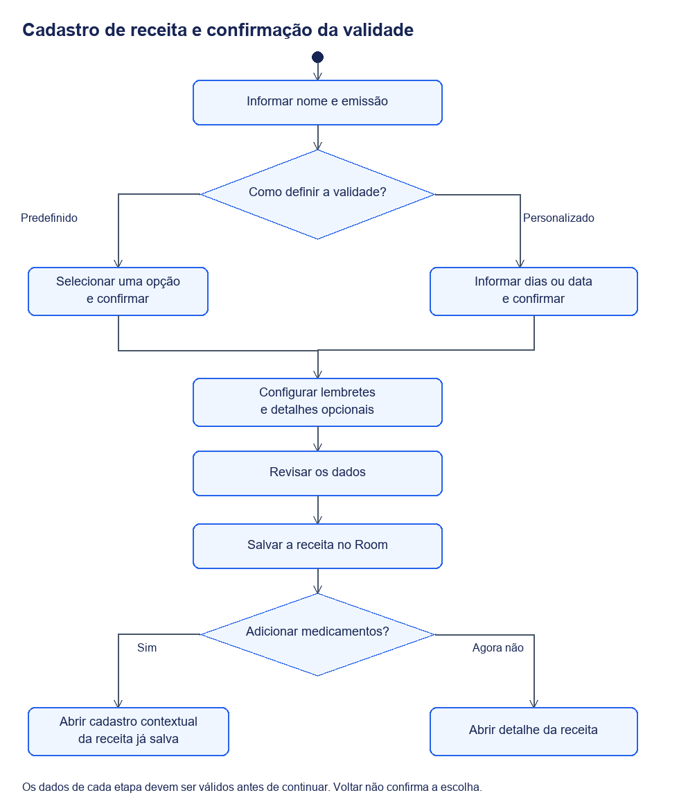
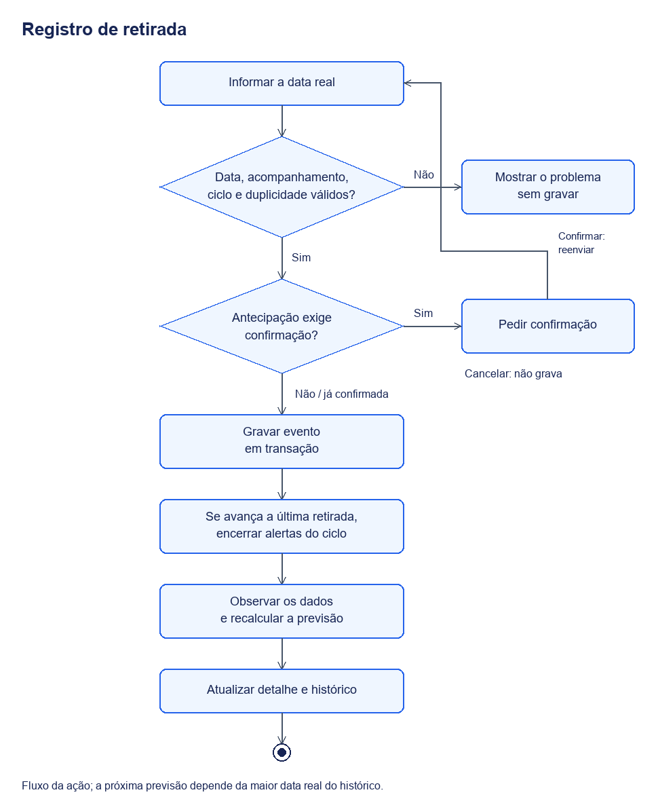

# Funcionamento do aplicativo

O uso do Receitas começa com dois registros que podem ser criados separadamente: uma receita médica e um medicamento. Depois do cadastro, a pessoa pode associá-los e configurar um acompanhamento de retiradas. Essa ordem permite cadastrar um documento antes de preencher seus medicamentos ou acompanhar uma compra sem selecionar receita.

## Cadastro da receita

Em Receitas, a ação + abre cinco etapas: nome, emissão e validade, lembretes, detalhes opcionais e revisão. Nome e dados de validade são obrigatórios. Profissional e observações ficam nos opcionais.

A receita é salva antes da inclusão de novos medicamentos. A confirmação oferece Adicionar medicamentos ou Agora não. Também é possível abrir o detalhe e usar Ver medicamentos para incluir itens posteriormente. A edição e a renovação preservam os itens existentes, apresentados para consulta na revisão; seu gerenciamento fica na lista da receita.

[Versão vetorial](imagens/fluxo-cadastro.svg). O diagrama mostra o percurso principal e a escolha da validade; a edição de campos e os cancelamentos podem retornar à etapa anterior sem salvar o documento.

## Validade da receita

O usuário informa a emissão e confirma o vencimento. A validade pode usar uma duração predefinida, uma duração personalizada ou uma data específica. O intervalo permitido no formulário é de 1 a 3650 dias. A emissão não pode ser futura.

| Opção apresentada | Prazo inicial |
| --- | --- |
| Uso contínuo | 180 dias |
| Antibiótico | 10 dias |
| Controlado | 30 dias |
| Farmácia Popular | 180 dias |
| Farmácia Básica (SUS) | 180 dias |
| Uso contínuo anual | 365 dias |
| Personalizado | Informado por dias ou data |

Essas são as opções de `PrescriptionType`, não uma declaração de aplicabilidade legal universal. O prazo deve ser conferido com o documento e as orientações recebidas. A seleção ajustável desses prazos atende aos [RF04–RF06](requisitos.md#requisitos-funcionais).

Selecionar uma opção altera um rascunho. Avançar confirma as opções predefinidas ou abre a definição personalizada. Voltar sem confirmar mantém a configuração anterior. O vencimento é a emissão mais a duração confirmada, salvo quando o registro já contém vencimento explícito. O dia do vencimento ainda é considerado válido.

## Medicamento e acompanhamento

O cadastro avulso é aberto pelo + em Remédios. Sem recorrência, passa por nome, retiradas, opcionais e revisão. Com recorrência, acrescenta etapas de antecedência e de local/receita para retiradas. Concentração, forma e princípio ativo ficam nos opcionais.

O acompanhamento usa uma data real de retirada e um intervalo. O formulário atual recebe dias; os modelos e os registros antigos ainda suportam semanas, meses e anos. Editar o intervalo pelo formulário passa a usar dias. Quantidade retirada é uma informação do acompanhamento, sem cálculo de estoque.

### Participação e receita para retiradas

Um medicamento pode aparecer em várias receitas, com orientações e quantidades prescritas diferentes. Esses dados pertencem a cada item do documento. Receitas vinculadas conta essa participação e abre a lista filtrada.

A receita para retiradas é uma escolha independente. Ela indica qual documento será comparado com as previsões do acompanhamento. A exceção é a inclusão pela lista de uma receita ativa: essa entrada já define a origem também como receita para retiradas. Receitas arquivadas precisam ser reativadas para essa inclusão; substituídas ficam somente para consulta.

## Registro de retirada

Registrar retirada solicita a data em que a retirada ou compra aconteceu. O sistema rejeita datas futuras, eventos repetidos no mesmo acompanhamento e operações sobre acompanhamento inativo. Uma operação iniciada a partir de um ciclo antigo também pode ser recusada. Antecipar a próxima retirada pode exigir confirmação adicional.

[Versão vetorial](imagens/fluxo-retirada.svg).

A previsão é calculada pela **maior data real registrada mais o intervalo**. Por exemplo, uma retirada em 10 de outubro com intervalo de 30 dias produz previsão para 9 de novembro. Registrar depois um evento retroativo de setembro acrescenta histórico, mas não faz a previsão voltar para outubro.

Corrigir ou excluir um evento recalcula a previsão a partir do histórico restante. Meses e anos seguem o calendário: 31 de janeiro mais um mês chega ao último dia de fevereiro. Isso é diferente de somar sempre 30 dias.

O detalhe apresenta as três últimas retiradas somente para leitura. A tela de histórico mostra todos os eventos, com data real e momento do registro. Corrigir e Excluir ficam no menu do evento.

## Lembretes e conflito entre prazos

O sistema calcula avisos de receita próxima do vencimento, vencendo hoje ou vencida; e de retirada próxima, na data ou atrasada. A antecedência é configurável. Os valores iniciais são cinco dias para receitas e três dias para retiradas.

Se a receita ativa escolhida para retiradas já foi emitida e vence antes da próxima previsão, o conflito pode gerar aviso mesmo fora da janela de antecedência. Uma receita que vence em 20 de novembro e uma retirada prevista para 25 de novembro ilustram essa situação. Registrar uma retirada não corrige, por si só, a validade do documento.

WorkManager agenda verificações periódicas, com verificações adicionais ao abrir o app e alterar dados. Alertas internos são armazenados no Room. A entrega na barra do Android depende de permissão, canal habilitado e condições de execução; não tem horário exato garantido.

Cada aviso tem identidade de ciclo e etapa. Ler, excluir ou limpar avisos não apaga receitas, medicamentos ou retiradas. Excluir suprime aquela etapa; etapas seguintes e ciclos futuros continuam elegíveis. Descartar o aviso na barra do Android não equivale a marcar o alerta interno como lido.

## Renovação, arquivamento e exclusão

Renovar cria uma receita com novo identificador, referenciando a anterior. O documento anterior passa a substituído, com seus dados preservados. Acompanhamentos que continuarem vinculados à receita substituída são arquivados; eventos não são apagados.

Arquivar uma receita também arquiva seus acompanhamentos vinculados. Reativar restaura esses acompanhamentos. Arquivar o acompanhamento de um medicamento preserva o histórico e encerra seus lembretes.

Excluir definitivamente uma receita remove seus itens e preserva acompanhamentos e retiradas sem esse vínculo. Excluir um medicamento remove seu acompanhamento e eventos, mas é bloqueado enquanto houver itens de receitas referenciando o medicamento. A interface distingue arquivamento de exclusão e pede confirmação.
