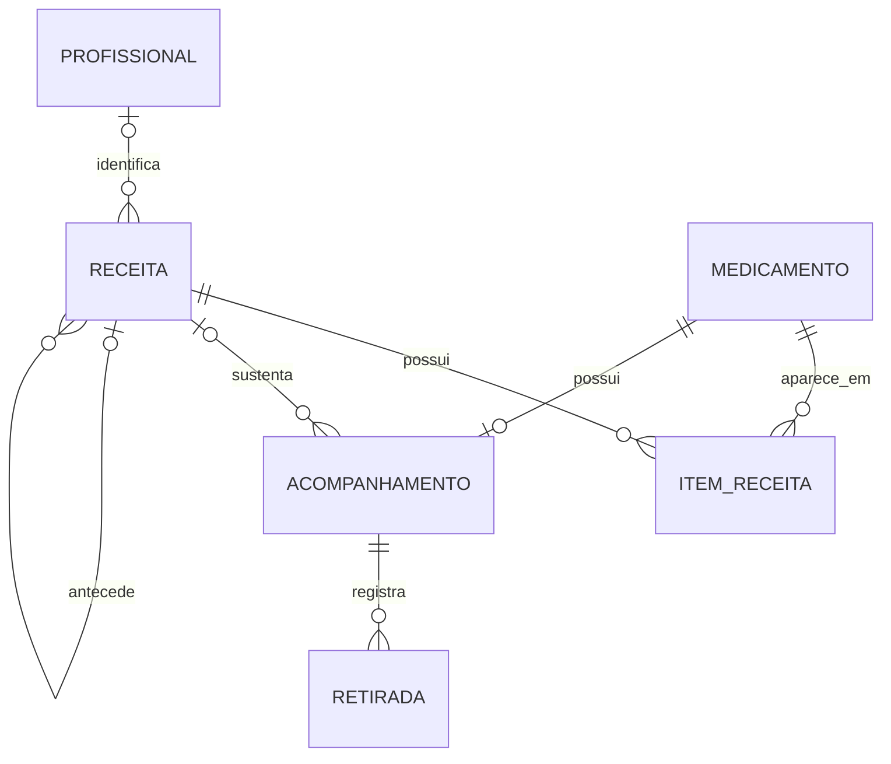

# Modelagem e regras de negócio

O app organiza receitas, vencimentos e retiradas. Não controla doses, estoque, fotos ou outras pessoas.

## Entidades atuais

- Medicamento: nome, princípio ativo, concentração e forma farmacêutica.
- Receita: emissão, validade confirmada, profissional registrado, observações, lembretes e situação do acompanhamento.
- Item da receita: relação receita–medicamento, orientação e quantidade prescrita. Preserva nome, concentração e forma apresentados no documento.
- Acompanhamento: um por medicamento; configuração da retirada, local, intervalo e receita opcional escolhida explicitamente pelo usuário.
- Retirada: evento com data real e momento de registro. Uma retirada por acompanhamento/data.
- Profissional: cadastro reutilizável. Receitas preservam nome, registro e especialidade próprios.
- Notificação: alvo, fase, ciclo e encerramento explícitos; texto exibido não determina regras.

## Relacionamentos

Participar de receitas pelos itens (`medicationIds`/`items`) e escolher uma receita para acompanhamento (`linkedPrescriptionId`) são relações distintas. Um medicamento pode constar em vários documentos, inclusive históricos, e usar outro para retiradas. A interface conta e filtra a participação; mostra a receita de acompanhamento separadamente. Consultar ou filtrar não cria vínculos nem altera regras de validade.

## Datas e intervalos

A próxima previsão usa a maior data real de retirada existente mais o intervalo configurado. Um registro retroativo entra no histórico sem regredir o ciclo. Correção e exclusão recalculam a previsão. Editar configurações não regrava retiradas existentes; a primeira data só é registrada na inicialização explícita de um acompanhamento vazio. Datas reais não podem estar no futuro; antecipação exige confirmação adicional.

Intervalos aceitam dias, semanas, meses ou anos. Meses e anos seguem o calendário: 31/01 mais um mês chega ao último dia de fevereiro; 29/02 mais um ano chega a 28/02 quando necessário. Cada cálculo parte da última retirada real.

Mudar o intervalo usa a última retirada real e mostra a nova previsão antes de salvar. Previsão não confirma disponibilidade ou autorização de dispensação.

A receita é válida da emissão até o vencimento, inclusive. Tipos sugerem prazos; o usuário pode confirmar um prazo ou escolher vencimento personalizado. O vencimento final e a origem do prazo são persistidos.

## Renovação

Registrar nova receita abre o cadastro preenchido com dados anteriores. O usuário confirma emissão, profissional, validade e itens. A nova receita recebe outro ID e aponta para a anterior. A anterior passa a substituída sem perder emissão, observações ou profissional.

Na etapa de retiradas, o usuário escolhe continuar o acompanhamento na nova receita, selecionar outra receita compatível ou manter sem receita. A transferência preserva eventos e próxima previsão. Acompanhamentos que continuam vinculados à receita substituída são arquivados.

## Arquivamento e exclusão

Receitas ativas geram lembretes; arquivadas e substituídas permanecem no histórico. Arquivar receita também arquiva seus acompanhamentos vinculados. Reativar restaura esses acompanhamentos.

Excluir receita é separado de arquivar e exige confirmação. Seus itens são removidos; acompanhamentos e retiradas permanecem sem esse vínculo. A cadeia das receitas restantes deixa de apontar para um documento excluído.

Acompanhamentos podem ser arquivados pelos detalhes do medicamento. Excluir definitivamente um medicamento remove seu acompanhamento e eventos e exige confirmação. A operação é bloqueada enquanto existirem itens de receita referenciando o medicamento.

## Persistência e migração

Room versão 4 exporta schema em app/schemas. Migrações explícitas suportam versões 2 e 3; não há fallback destrutivo nem inclusão automática de exemplos.

A versão 3 é convertida para itens, acompanhamentos e um evento para cada última retirada conhecida. Vínculos ausentes são preservados nas colunas legadas, mas não viram relações inválidas. Nenhuma receita é inferida para um acompanhamento: a escolha fica com o usuário. Aliases de tipos são normalizados sem mudar a validade confirmada.

A versão 2 preserva medicamentos antigos em legacy_medications_v2 e mantém tabelas legadas de doses. Sua orientação é convertida em texto para consulta. Campos antigos de estoque e anexos ficam apenas preservados no banco, sem controles ativos no produto.

Operações completas usam transações. Itens, acompanhamentos, eventos, profissional e cadeia de receitas têm chaves estrangeiras e índices. Histórico já sobrescrito nas versões anteriores não pode ser recuperado.

## Verificação

Testes unitários cobrem datas, intervalos de calendário, vínculos explícitos, estados e rascunhos. Testes instrumentados cobrem migrações 2/3, transações e rollback, independência de orientações/apresentações, renovação, histórico retroativo, antecipação, arquivamento, exclusão e fluxos de interface.
