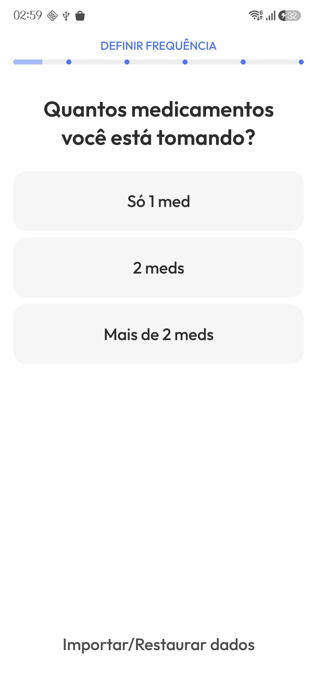
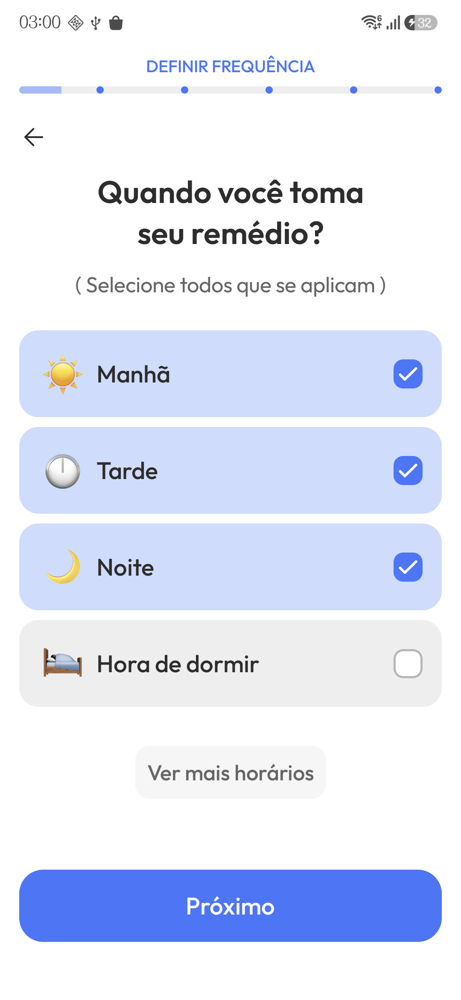
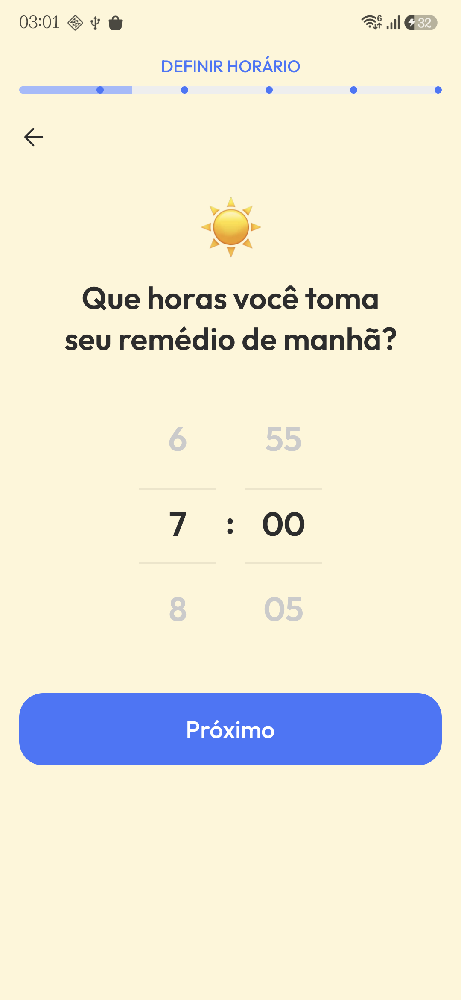
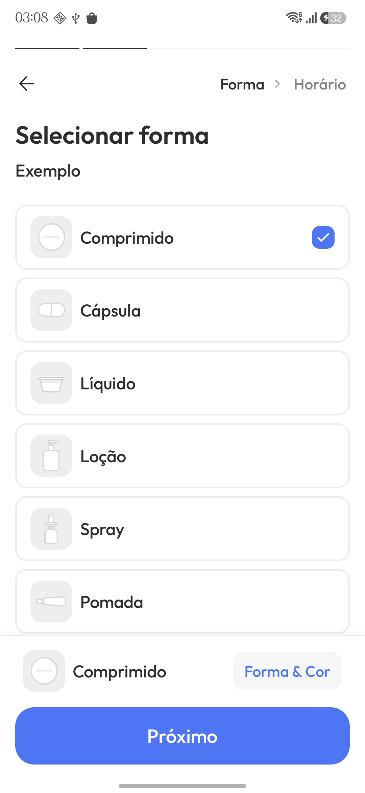

# Referência de cadastro: Pillo

Pesquisa do aplicativo de terceiro. O padrão implementado de listas agrupadas, detalhes, timeline e cadastro está em [DESIGN.md](../DESIGN.md); as observações abaixo não são especificações do Receitas.

Análise feita em 14/10/2026 no Pillo para Android, aberto no Samsung A57 (SM-A576B) do usuário. As observações abaixo vêm da interface acessada no aparelho, e não de especificações Samsung. Nenhuma medida, cor ou token foi extraído por estimativa.

## Cadastro observado

O cadastro de medicamento percorre nome, forma, frequência, horário e quantidade de dose. O topo apresenta progresso, retorno, etapa atual e próxima etapa. O botão principal fica na base; os campos e escolhas ocupam a área central.

- **Nome:** entrada de texto, com alternativas de escanear e buscar por tratamento. Foi usado o nome fictício “Exemplo” para percorrer o formulário, sem concluir esse cadastro.
- **Forma:** cartões com ícone, texto e marca de seleção. Foram vistos comprimido, cápsula, líquido, loção, spray e pomada. Um resumo inferior mostra a seleção e uma ação adicional “Forma & Cor”.
- **Frequência:** escolhas agrupadas em Diário, Periódico e Quando precisar. Foram vistas opções de uma, duas, três ou mais doses diárias, padrão personalizado, dias específicos, intervalos em horas e dias alternados.
- **Horário:** seletor de hora, data inicial e opção “Horário diferente por dia”.
- **Dose:** quantidade e unidade, com acesso a padrão de dose personalizado. A tela exibe “Concluído”; essa ação não foi acionada. O próximo assunto indicado no topo era concentração, mas seu formulário não foi inspecionado.

## Introdução observada

A configuração inicial pergunta a quantidade de medicamentos e os períodos do dia, depois apresenta um seletor de horário para cada período. Em seguida, separa tipo, tema e som do alarme em telas próprias. Esse percurso é diferente do cadastro normal de medicamento.

Ao terminar a introdução, o Pillo criou automaticamente “Meu medicamento 01”, com horários de 7h, 12h e 18h. A permissão de sobreposição foi pulada pela opção “Não uso lembretes”. A exploração foi interrompida por indisponibilidade da revisão automática de aprovação antes de remover esse registro do aparelho. Não confundir esse exemplo com dados reais do usuário ou com um recurso implementado no Receitas.

## Capturas preservadas

Estas imagens são referências de pesquisa do aplicativo de terceiro; não são assets de produção do Receitas.

## Aplicação proposta para o Receitas

Estas são interpretações para o projeto, não reprodução de requisitos do Pillo nem especificações Samsung:

- Usar perguntas e títulos diretos, deixando clara a decisão de cada grupo.
- Apresentar escolhas recorrentes em controles compartilhados com toda a área clicável, texto e seleção explícita.
- Manter progresso, retorno e ação principal previsíveis; informar o próximo assunto no botão.
- Revelar configurações adicionais conforme a escolha, sem criar uma etapa para cada campo.
- Agrupar campos relacionados e preservar revisão e confirmação explícita antes de salvar. Evitar a criação automática de um medicamento genérico observada na introdução do Pillo.
- Reutilizar componentes do Receitas e os tokens de `DesignSystem.kt`. Não copiar cores, mascote, ícones ou dimensões do Pillo.
- Preservar a distinção entre horários de tomada de doses no Pillo e frequência de retirada/reposição no Receitas; a semelhança visual não autoriza mudar regras de negócio.
- Validar qualquer implementação futura em telas pequenas, fonte 200%, conteúdo longo, teclado e temas claro/escuro.

O cadastro de consultas, a tela de concentração, o salvamento final e o comportamento de edição após salvar ainda não foram analisados. Esta referência documenta somente o percurso observado; não altera a interface atual.

## Fontes públicas complementares

- [Pillo no Google Play](https://play.google.com/store/apps/details?hl=pt_BR&id=xyz.rtrvr.pillo)
- [Site oficial](https://pillo.care/)
- [FAQ oficial](https://pillo.care/faqs)

As fontes públicas complementam a identificação do app e suas funcionalidades; não substituem a observação das telas de cadastro no aparelho.
