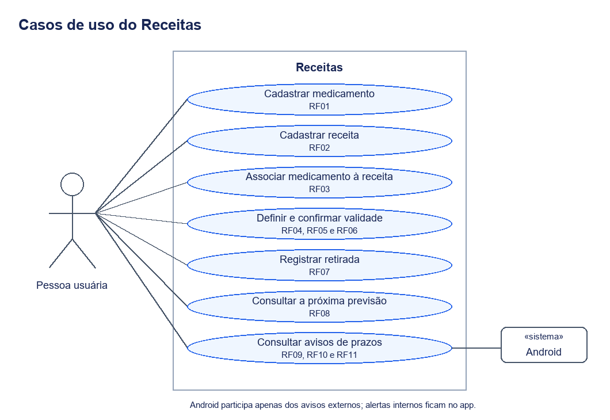

# Requisitos e casos de uso

O objetivo do Receitas é apoiar a organização pessoal de receitas, medicamentos e datas previstas de retirada ou compra. O protótipo mantém separadas a validade do documento e a previsão de obtenção do medicamento, permitindo identificar quando esses prazos entram em conflito.

Os identificadores RF01–RF11 e RNF01–RNF05 seguem as tabelas de requisitos do rascunho do TCC. A descrição abaixo associa esses requisitos ao comportamento atual do aplicativo. Ela não substitui a fundamentação acadêmica nem apresenta o sistema como instrumento de autorização de dispensação.

## Casos de uso

A pessoa usuária cadastra os dados e acompanha os resultados. O Android participa da entrega de notificações externas. Não há atores de autenticação, serviço de farmácia ou profissional operando remotamente o aplicativo.

[Versão vetorial do diagrama](imagens/casos-de-uso.svg).

## Requisitos funcionais

| Código | Comportamento | Onde aparece |
| --- | --- | --- |
| RF01 | Cadastrar informações de medicamentos | Cadastro de medicamento avulso ou inclusão pela receita |
| RF02 | Cadastrar receitas médicas | Cadastro do documento, com nome, emissão e validade |
| RF03 | Associar uma receita aos medicamentos correspondentes | Lista de medicamentos da receita e itens prescritos |
| RF04 | Informar uma data específica de validade | Validade personalizada por data |
| RF05 | Sugerir validade conforme uma referência selecionada | Opções predefinidas de validade |
| RF06 | Confirmar ou alterar a sugestão | Editor de validade com rascunho e confirmação |
| RF07 | Registrar a última retirada | Registro de evento com data real |
| RF08 | Calcular a próxima data pelo registro anterior e intervalo | Previsão baseada na retirada real mais recente |
| RF09 | Alertar sobre a proximidade do vencimento | Alertas internos e notificações de receitas |
| RF10 | Avisar sobre próximas retiradas ou compras | Lembretes do acompanhamento recorrente |
| RF11 | Identificar validade anterior à próxima retirada | Comparação com a receita escolhida para o acompanhamento |

Há implementação correspondente aos onze requisitos. A existência de código não demonstra, sozinha, todos os resultados de execução; os cenários e as limitações dessa verificação estão em [Validação](validacao.md).

RF11 tem uma condição importante: o aviso compara a previsão com a receita ativa escolhida para retiradas, não com todos os documentos em que o medicamento aparece. Se o acompanhamento estiver sem receita, não há documento selecionado para essa comparação. Vencimento no mesmo dia da retirada não é conflito.

## Requisitos não funcionais

| Código | Critério do trabalho | Como é abordado e o que precisa ser avaliado |
| --- | --- | --- |
| RNF01 | Informações e ações claras e consistentes | Componentes, tema e padrões de interação compartilhados; clareza precisa ser avaliada em percursos de uso |
| RNF02 | Retorno após cadastro, alteração e retirada | Confirmações e mensagens de sucesso ou falha nos fluxos |
| RNF03 | Estados, datas e avisos identificáveis | Situações explícitas de registro e alerta, com texto além da cor |
| RNF04 | Evitar exposição indevida de informações de saúde | Armazenamento local, backup desativado e visibilidade privada das notificações; essas medidas não constituem uma avaliação completa de segurança |
| RNF05 | Manter registros após encerrar e reabrir | Persistência Room dos dados salvos; rascunhos não confirmados têm recuperação temporária e não são registros definitivos |

Os critérios de clareza e identificação não devem ser declarados atendidos apenas porque existem componentes ou testes automatizados. Uma avaliação do percurso precisa produzir evidências, conforme [Validação](validacao.md).

## Recursos complementares

O aplicativo também oferece edição, busca, filtros, agenda, arquivamento e reativação. A renovação cria outro documento preservando o anterior. O histórico mantém todas as retiradas e permite corrigir ou excluir eventos. Esses recursos ampliam o gerenciamento descrito nos RF, sem acrescentar controle de doses ou avaliação clínica.

A relação entre os recursos fica detalhada em [Funcionamento](funcionamento.md). O cadastro de profissionais é uma informação de apoio à receita, não um perfil de atendimento ou uma conta de acesso.

## Detalhamento das regras no protótipo

As verificações em segundo plano usam WorkManager e não têm horário exato garantido. Os avisos internos e a entrega de notificações externas são partes diferentes da solução; esse detalhe importa ao verificar RF09 e RF10.

O aplicativo agrupa as sugestões em sete opções, algumas com o mesmo prazo de 180 dias. A tabela de [validade da receita](funcionamento.md#validade-da-receita) descreve os valores implementados. Essas opções são referências ajustáveis: a seleção de uma categoria não comprova que o documento atende às normas de dispensação.
